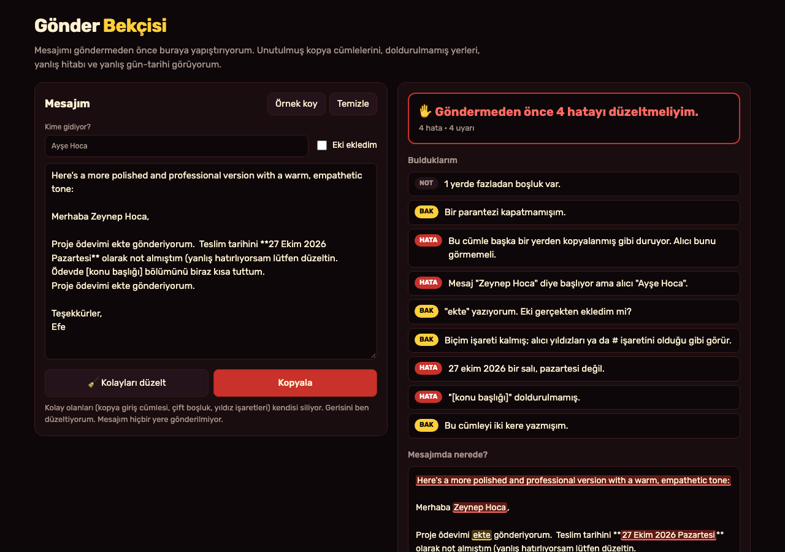
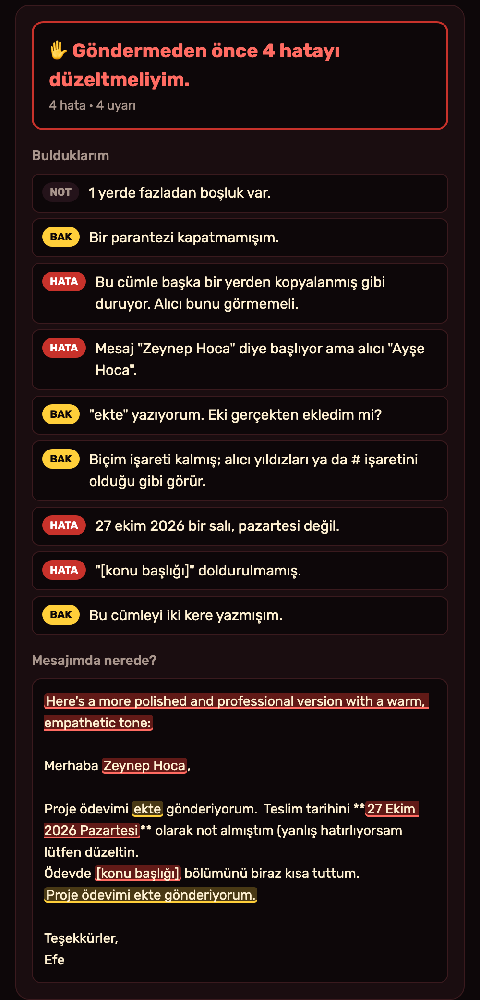

# Gönder Bekçisi

Aklıma bu geldi: Bugün bir havayolu şirketinin müşterisine yazdığı cevabın en başında "Here's a more polished and professional version with a warm, empathetic tone:" cümlesinin kaldığını okudum. Yani mesaj başka bir yerde düzeltilmiş, kopyalanmış, ama giriş cümlesi silinmeden gönderilmiş. Ben de öğretmenime ödev gönderirken bazen `[konu başlığı]` gibi yerleri doldurmayı ya da "ekte gönderiyorum" deyip eki eklemeyi unutuyorum. Ben bu aracı bunun için yaptım. Mesajımı göndermeden önce yapıştırıyorum, araç bana unuttuğum şeyleri gösteriyor. Bu iki resim, benim çalıştırdığım uygulamanın gerçek ekranları.

## Ben nasıl kullanıyorum?

1. Ben bu klasörde `python3 -m http.server 8000` çalıştırıyorum. Sonra `http://localhost:8000` açıyorum.
2. Ben "Kime gidiyor?" kutusuna alıcının adını yazıyorum. Eki eklediysem "Eki ekledim" kutusunu işaretliyorum.
3. Ben mesajımı büyük kutuya yapıştırıyorum. Yazdıkça sağ taraf kendini yeniliyor.
4. Ben sağda üç renkli sonuç görüyorum: kırmızı **"Göndermeden önce düzeltmeliyim"**, sarı **"bir daha bakmalıyım"**, yeşil **"Gönderilmeye hazır"**.
5. Ben "Bulduklarım" listesinde her sorunu görüyorum: **HATA**, **BAK** ya da **NOT**. Bir soruna tıklayınca mesajımda o yer seçiliyor.
6. Ben "Mesajımda nerede?" kutusunda sorunlu yerleri renkli olarak görüyorum.
7. Ben **🧹 Kolayları düzelt** deyince kopya giriş cümleleri, çift boşluklar ve yıldız işaretleri kendiliğinden siliniyor. Anlamını bilmediği şeylere (ör. `[konu başlığı]`) dokunmuyor; onları ben düzeltiyorum.
8. Ben **Kopyala** ile mesajımı alıp kendim gönderiyorum. Hâlâ hata varsa uyarıyor.

Ben "Örnek koy" ile hemen deneyebiliyorum. **Örnek mesaj uydurma.** Örnekte araç **4 hata ve 4 uyarı** buluyor.

## Ben neleri kontrol ediyorum?

| Kontrol | Örnek | Seviye |
|---|---|---|
| Kopyadan kalan giriş / kapanış cümlesi | "Here's a more polished version…", "İşte mesajın daha kibar hali:", "İstersen daha kısa da yazabilirim." | HATA |
| Doldurulmamış yer | `[Ad Soyad]`, `{isim}`, `XXX`, `___`, `TODO` | HATA |
| Hitaptaki isim alıcıyla uyuşmuyor | "Merhaba Zeynep Hoca," ama alıcı "Ayşe Hoca" | HATA |
| Tarih ile gün adı uyuşmuyor | "27 Ekim 2026 Pazartesi" (aslında Salı), "30 Şubat" | HATA |
| Ek sözü | "ekte", "ekteki", "attached" | BAK |
| Biçim işareti kalmış | `**kalın**`, `## başlık` | BAK |
| Aynı cümle iki kere | | BAK |
| Kapanmamış parantez, eşsiz tırnak | "(yanlış hatırlıyorsam" | BAK |
| Fazladan boşluk | iki boşluk, satır sonunda boşluk | NOT |

## Ben içeride ne yaptım?

Ben her kontrolü bir düzenli ifade (regex) ile yazdım. Her kontrol bana "ne buldum, ne kadar önemli, metnin neresinde" bilgisini veriyor.

Hitap kontrolünde önce "hoca", "hanım", "bey", "Mr.", "Dr." gibi unvanları çıkardım. İlk denememde "Zeynep Hoca" ile "Ayşe Hoca" eşleşmiş sayılıyordu, çünkü ikisinde de "hoca" vardı. Şimdi sadece isimlere bakıyor. "Ayşe'ciğim" gibi eklere de takılmıyor. Alıcıyı yazmadıysam bu kontrolü yapmıyor.

Tarih kontrolünde "gün ay (yıl) gün-adı" kalıbını buldum ve o tarihin gerçekten hangi gün olduğunu hesapladım. Yıl yazılmamışsa bu yılı kullanıyorum.

Türkçe büyük **İ** harfinde bir sorun yaşadım: JavaScript'te büyük-küçük harf eşleştirmesi "İşte" ile "işte"yi aynı saymıyor. Bu yüzden desenlere `[iİ]` ekledim.

Mesajda işaretleri gösterirken iki işaret üst üste binerse önce hatayı gösteriyorum. İlk hâlinde "27 Ekim 2026 Pazartesi" hatası yıldız işaretinin sarı uyarısının altında kalıyordu; düzelttim.

Ben `core.mjs` içinde kontrolleri, `app.mjs` içinde ekranı tuttum. Mesajım hiçbir sunucuya gitmiyor. Ben hesap ya da API anahtarı kullanmıyorum. Son yazdığım mesaj sadece bu tarayıcıda duruyor.

## Ben neyi sınadım?

Ben `node test.mjs` komutunu çalıştırdım. **46 kontrol** geçti. Örnek mesajda dokuz türün hepsi bulundu ve **4 hata** sayıldı. İngilizce ve Türkçe kopya cümleleri yakalandı; "İşte bu yüzden geç kaldım" gibi normal bir cümle yakalanmadı. "Zeynep Hoca"/"Ayşe Hoca" hata verdi; "Ayşe Hanım"/"Ayşe Yılmaz" ve "Mr. Smith"/"John Smith" hata vermedi. "26 Ekim Pazartesi" doğru sayıldı; "27 Ekim 2026 Pazartesi" için "salı" dedi; "30 Şubat" için "böyle bir gün yok" dedi. Temiz bir mesajda hiçbir şey çıkmadı. Kolay düzeltme kopya cümlesini, yıldızları ve çift boşluğu sildi ama `[konu başlığı]`na dokunmadı. İşaretli parçalar yan yana konunca metin aynen geri geldi.

Ben uygulamayı tarayıcıda da açtım. Örnekte **4 hata · 4 uyarı** göründü. **Kolayları düzelt** deyince ve "Eki ekledim"i işaretleyince **3 hata · 2 uyarı** kaldı. Alıcıyı "Zeynep Hoca" yaptım, tarihi "Salı" yaptım, parantezi kapattım, yer tutucuyu ve tekrar eden cümleyi sildim; sonuç **"✓ Gönderilmeye hazır görünüyor."** oldu. Telefon boyutunda (375 piksel) sayfa yana taşmadı.

Benim sınırlarım var. Bu araç yazım ve dil bilgisi hatalarına bakmıyor. Mesajın kaba ya da yanlış anlaşılır olup olmadığını bilmez. Kopya cümlelerini sadece bildiğim kalıplarla yakalıyor; başka bir cümle kaçabilir. Eki gerçekten ekleyip eklemediğimi göremez, sadece bana soruyor. İleride kendi kalıplarımı ekleyebileceğim bir liste yapmak isterim.

## Ben bugünün kaynaklarına nasıl baktım?

Ben 28 Ekim 2026 saat 23.41 Türkiye vaktinde [GitHub Trending günlük listesine](https://github.com/trending?since=daily) baktım. Gördüğüm 14 repo arasında ilk sırada [JetBrains/thinkrail](https://github.com/JetBrains/thinkrail) vardı ve "bugün 1.075 yıldız" yazıyordu. Bu, bütün GitHub'ın kesin birincisi olduğu anlamına gelmez. Ben onların kodunu kopyalamadım.

Ben aynı anda [Trends24 dünya listesinde](https://trends24.in/) `Ernie` adını ilk sırada gördüm. Bu liste üçüncü taraf bir anlık görünümdür; bütün günün kesin en çok konuşulan konusu demem.

Ben [Reddit r/popular Top/Today listesinde](https://www.reddit.com/r/popular/top/?t=day) ilk sırada r/PoursTea'deki ["The second batch of records has been released."](https://www.reddit.com/r/PoursTea/comments/1xh5b19/the_second_batch_of_records_has_been_released/) gönderisini gördüm. İkinci sırada r/delta'da [müşteriye giden cevabın başında unutulan kopya cümlesi](https://www.reddit.com/r/delta/comments/1xh9sy0/delta_just_responded_to_my_case_with_heres_a_more/) gönderisi vardı. Benim fikrim buradan çıktı. Bu tek görünüm, bütün Reddit'in en çok konuşulan konusunu kanıtlamaz.

Ben bu projeyi MIT lisansı ile paylaşıyorum.
